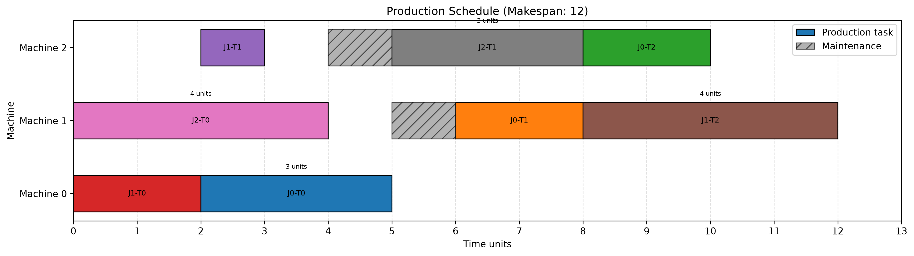

# Production Planning and Scheduling Optimizer

An optimization-based production scheduling system built with Python and Google OR-Tools CP-SAT. It schedules manufacturing jobs across machines while respecting task precedence and planned machine maintenance.

## Problem Statement

In manufacturing, multiple jobs require operations on different machines. Poor scheduling can cause machine conflicts, production delays, and inefficient resource utilization.

This project models the production planning problem as a job-shop scheduling optimization problem and minimizes the total completion time (makespan).

## Features

- Load job and maintenance data from CSV files.
- Validate input data before optimization.
- Optimize job scheduling using OR-Tools CP-SAT.
- Enforce task precedence and machine availability constraints.
- Account for planned machine maintenance.
- Validate the generated schedule.
- Calculate makespan and machine-wise utilization.
- Generate a Gantt chart and scheduling report.
- Export schedules and metrics to CSV files.
- Run automated tests with pytest.

## Production Schedule Visualization

The Gantt chart below shows the optimized task schedule across machines,
including planned maintenance periods.

## Tech Stack

- Python
- Google OR-Tools (CP-SAT)
- pandas
- Matplotlib
- pytest

## Project Structure

    data/
        sample_data.csv
        sample_data2.csv
        schedule_output.csv
        machine_metrics.csv
        schedule_gantt.png
        scheduling_report.txt
    src/
        data_validation.py
        scheduler.py
        validation.py
        metrics.py
        visualization.py
        report.py
    tests/
        test_scheduler.py
        test_report.py
    main.py

## How It Works

1. Load job and maintenance data.
2. Validate the input data.
3. Build the job-shop scheduling model.
4. Minimize makespan subject to scheduling constraints.
5. Validate the generated schedule.
6. Calculate performance metrics.
7. Export results and generate visualizations and reports.

## Setup

Install [uv](https://docs.astral.sh/uv/) if it is not already installed.

Clone the repository, navigate to the project directory, and install dependencies:

    uv sync

Run the optimizer:

    uv run python main.py

Run the tests:

    uv run python -m pytest -v

## Outputs

| Output | Description |
|---|---|
| `schedule_output.csv` | Scheduled task start and end times |
| `machine_metrics.csv` | Machine processing time and utilization |
| `schedule_gantt.png` | Visual production schedule |
| `scheduling_report.txt` | Summary of solver results and metrics |

## Optimization Objective

The model minimizes makespan:

    Minimize maximum(task completion time)

Subject to:
- Tasks within each job follow the required order.
- A machine processes at most one operation at a time.
- Tasks do not overlap planned maintenance periods.

## Testing

Automated tests cover scheduling feasibility, precedence constraints, machine conflicts, maintenance handling, task completeness, assignment correctness, metrics, and report generation.

## Future Improvements

- Support alternative machines for operations.
- Add job priorities and delivery deadlines.
- Compare optimized schedules against baseline scheduling rules.
- Develop a web dashboard for interactive scheduling.
- Evaluate schedule performance on larger datasets.
